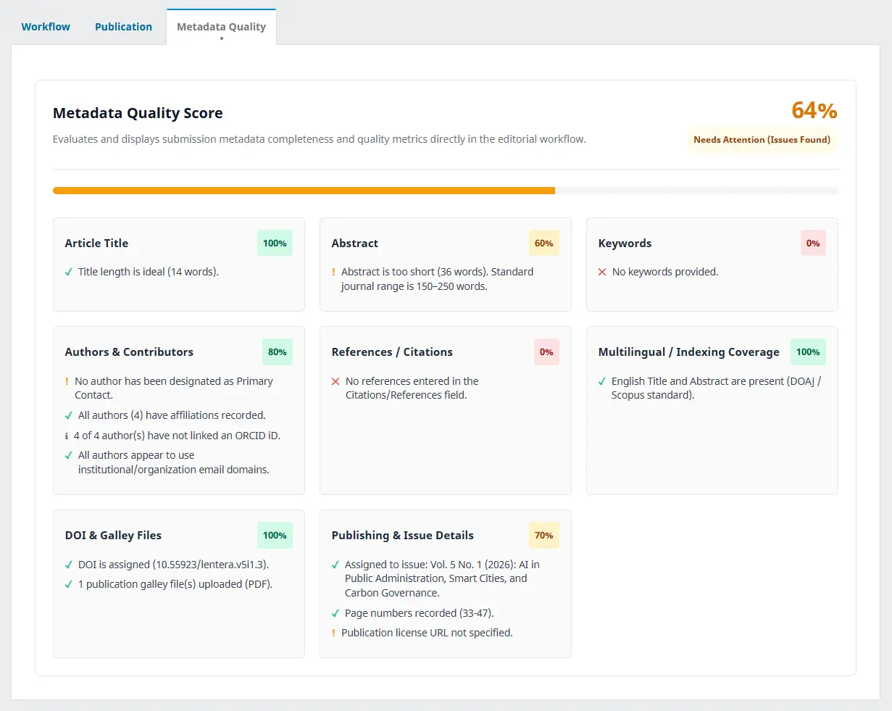

# OJS Metadata Quality Checker Plugin

[](https://www.php.net/)
[](https://www.smarty.net/)
[](https://developer.mozilla.org/en-US/docs/Web/CSS)
[](https://developer.mozilla.org/en-US/docs/Web/HTML)
[](https://pkp.sfu.ca/ojs/)
[](LICENSE)

A lightweight editorial quality tool for Open Journal Systems (OJS) 3.4+. Automatically audits article metadata completeness and scoring directly in the editorial workflow tabs without altering your database schema.



## Key Features

- **Automated Metadata Audit**: Real-time evaluation of submission metadata.
- **Workflow Tab Integration**: Injected natively via `Template::Workflow` hook as a standalone tab alongside Submission, Review, Copyediting, and Production.
- **Scoring & Status Categories**:
  - `Excellent (85-100%)`: Ready for publication and indexing.
  - `Good (70-84%)`: Minor improvements recommended.
  - `Needs Attention (50-69%)`: Missing vital fields (affiliations, abstract length, etc.).
  - `Critical (<50%)`: Missing required foundational metadata.
- **Comprehensive Quality Rules**:
  - **Title**: Length check (5-25 words), ALL CAPS detection.
  - **Abstract**: Word count validation (100-300 words), empty state detection.
  - **Keywords**: Minimum count checks (≥ 3), accidental comma merge detection.
  - **Authors & Affiliations**: Primary contact presence, missing institution, missing country, ORCID presence, and institutional email detection.
  - **References / Citations**: Minimum reference count detection (≥ 10 entries) and DOI link detection.
  - **Multilingual / Coverage**: English title & abstract presence for international indexing (DOAJ, Scopus, Google Scholar).
  - **DOI & Galley Files**: Checks assigned publication DOI and verifies reader-accessible galley file uploads (PDF/HTML).
  - **Publishing & Issue Details**: Issue scheduling status, page numbers / article number, and publication license URL configuration.
- **Zero Database Pollution**: Calculates metrics dynamically from current publication objects without storing redundant tables.
- **Role-Based Visibility**: Restricts report access to Site Admins, Journal Managers, Section Editors, and Authors.
- **Multilingual Support**: English (`en`) and Indonesian (`id`) locale files included.

## System Requirements

- Open Journal Systems (OJS) 3.4.0 or higher
- PHP 8.0, 8.1, 8.2, 8.3, or 8.4

## Installation

1. Clone or copy the repository to your OJS plugins directory:
   ```bash
   git clone https://github.com/dimartarmizi/ojs-metadata-quality-checker.git plugins/generic/metadataQualityChecker
   ```
   *Or extract the release zip into `plugins/generic/metadataQualityChecker`.*

2. Ensure correct directory permissions:
   ```bash
   chmod -R 755 plugins/generic/metadataQualityChecker
   ```

3. Log in to OJS as Journal Manager or Site Administrator.

4. Navigate to **Settings > Website > Plugins > Installed Plugins**.

5. Locate **Metadata Quality Checker Plugin** under Generic Plugins and enable it.

6. Open any submission in the editorial workflow and click the **Metadata Quality** tab.

## Authors & Maintainers

- **Author**: Dimar Tarmizi
- **Organization**: [Open Journal Center](https://github.com/openjournalcenter)
- **Repository**: [https://github.com/dimartarmizi/ojs-metadata-quality-checker](https://github.com/dimartarmizi/ojs-metadata-quality-checker)

## License

This plugin is licensed under the [GNU General Public License v3.0](LICENSE).

